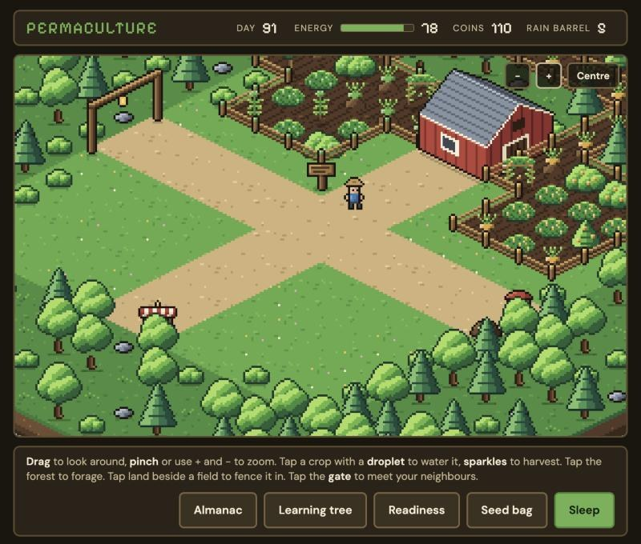
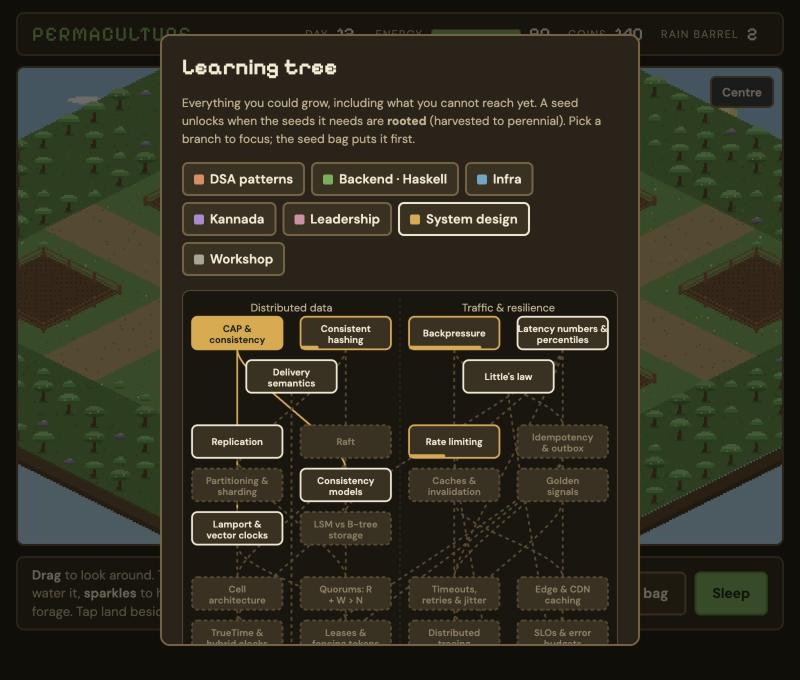

# Permaculture

A farm game where the crops are the things you are learning. Forgetting is wilting. Mastery is a tree.

**Play:** [yozo06.github.io/permaculture](https://yozo06.github.io/permaculture/). To play on your own machine, run `npm run dev` and open the address it prints; it ends in `/permaculture/`, like the live site.



Topics are seeds. Plant one in its field with notes in your own words, water it by answering cards and then by explaining it, and it grows. Leave it thirsty for two days and it wilts, unless the rain barrel has a day to spend; a wrong answer wilts it at once. Harvest a stage-5 crop with a harder question, a write-up or proof, and it becomes a perennial tree: rooted, yours for good. The map is your retention, drawn as land.

Any goal is a **pack**: a YAML file of seeds with layers, prerequisites and questions. The game is built from `packs/`: add a seed to a YAML file and it is in the game. The packs so far are a senior backend engineer's prep (Haskell, system design, infra, DSA patterns, leadership) and everyday Kannada. The game's own roadmap is a pack too.



## Status

Phase 1 is done: the rules are an engine of their own (a farm is a fold over a log of what you did), the game is built from `packs/`, and a crop climbs a depth ladder — notes when you plant it, recall cards, explaining it in your own words, then a harder harvest. There are seven packs and 208 seeds: five full catalogues (Haskell backend, system design, infra, DSA patterns, leadership), everyday Kannada, and the Workshop, the game's own roadmap. The pixel art is still procedural, with a drag-to-pan world, a learning tree, wild finds and an almanac. Everything runs in your browser; your farm is saved there. Export it from the seed bag before clearing site data. Farms from the Phase 0 prototype still import.

Next is Phase 2, **Neighbours**: farms you can see and rain you can send, with no server and no accounts (`docs/neighbours.md`). After it comes optional AI with your own key, then art.

Why this exists, what it promises and the whole plan are in [`ROADMAP.md`](ROADMAP.md).

## Repo

```
src/       the game: TypeScript, built with Vite
  engine/  the rules: pure TypeScript, a farm is a fold over an event log
  game/    the canvas, the sheets, saving
packs/     one YAML per goal · schema/ · validated in CI
docs/      design.md (the rules) · neighbours.md · pack-format.md · code-tour.md
ROADMAP.md the vision, the mission and the plan
scripts/   the pack validator (shared with the build) and its tests
```

New to the code? `docs/code-tour.md` is a one-page walk through it: the three parts, how a tap becomes a saved farm, and where to make a change.

```sh
npm install           # needs Node 22.12 or newer
npm run dev           # play locally at /permaculture/, with hot reload
npm run validate      # every pack against the schema, plus cycle and prerequisite checks
npm test              # unit and property tests
npm run build         # type-check, then build the site into dist/
```

## Contributing

Read `CONTRIBUTING.md`. The most useful contribution is a pack for a goal of your own. `ROADMAP.md` says where help is wanted; the backlog itself is a pack, `packs/workshop.yaml`.

## Licence

Code MIT. Packs CC-BY-SA 4.0.
